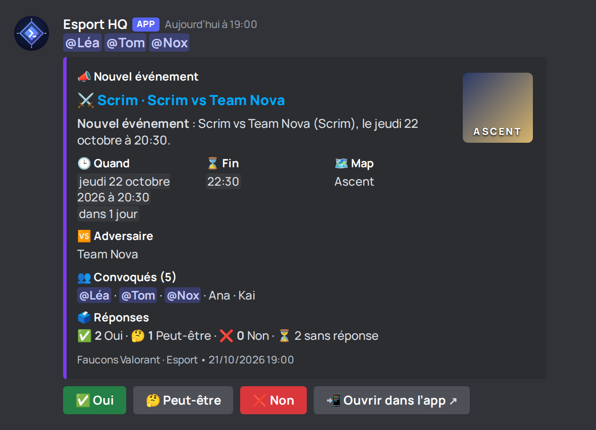

# Esport : le bot Discord « Esport HQ »

Le bot vit dans le serveur Discord de la team. Il **annonce** les scrims, matchs, tournois, entraînements et
réunions, **rappelle** la veille (J-1), une heure avant (H-1) et au début (« c'est maintenant »), et **mentionne
seulement les joueurs convoqués** qui ont lié leur compte. Sous chaque annonce, trois boutons : **Oui**,
**Peut-être**, **Non**. Un clic met à jour la présence dans l'app, et l'annonce se met à jour toute seule
(compteurs ✅ / 🤔 / ❌).

Les joueurs ont aussi des commandes : `/prochain`, `/planning`, `/rsvp`, `/dispo`, `/taches`, `/strat`, `/resume`,
`/aide`. Le staff a `/evenement-creer` et `/relancer`.



Autres aperçus (rendus avec le vrai code du bot) : [rappel H-1](bot/apercus/02-rappel-h1-match.png),
[relance groupée](bot/apercus/03-relance-groupee.png), [c'est maintenant](bot/apercus/04-c-est-maintenant.png),
[/prochain](bot/apercus/05-commande-prochain.png), [/taches](bot/apercus/06-commande-taches.png),
[/aide](bot/apercus/07-commande-aide.png), [clic sur Oui](bot/apercus/08-rsvp-confirme.png). Tous :
[bot/apercus/index.html](bot/apercus/index.html).

Pas de serveur à faire tourner : Discord appelle le serveur Esport (le Worker Cloudflare) quand quelqu'un tape une
commande ou clique un bouton.

---

## Activer le bot (Fondateur, une seule fois, environ 15 minutes)

### 1. Créer l'application sur Discord

1. Ouvrez **https://discord.com/developers/applications** (connectez-vous avec votre compte Discord).
2. Bouton **New Application** en haut à droite. Nom : **Esport HQ** (conseillé). Cochez la case, **Create**.

### 2. Récupérer les trois valeurs

1. Page **General Information** :
   - **Application ID** : bouton **Copy**. Gardez-le (c'est un nombre, ce n'est pas un secret).
   - **Public Key** : bouton **Copy**. Gardez-la (64 caractères, ce n'est pas un secret non plus).
2. Menu de gauche **Bot** :
   - bouton **Reset Token**, confirmez, puis **Copy** : c'est le **Bot Token**. **C'est un secret** : qui l'a peut
     parler à la place du bot. Ne le collez nulle part ailleurs qu'à l'étape 3.
   - Laissez **Public Bot** comme vous voulez (désactivé : vous seul pouvez l'inviter). Les « Privileged Gateway
     Intents » ne servent pas : laissez-les éteints.

### 3. Poser les valeurs (GitHub)

Sur GitHub, dépôt **application-Enzo** › **Settings** › **Secrets and variables** › **Actions** :

1. Onglet **Variables** › **New repository variable** :
   - `DISCORD_APPLICATION_ID` = l'Application ID ;
   - `DISCORD_PUBLIC_KEY` = la Public Key.
2. Onglet **Secrets** › **New repository secret** :
   - `DISCORD_BOT_TOKEN` = le Bot Token.

Le workflow Esport pose tout seul le jeton sur le serveur. Autre façon (sur un PC, dans le dossier de l'app) :

```
npx wrangler secret put DISCORD_BOT_TOKEN --config esport/wrangler.toml
```

(il demande le jeton ; rien n'est écrit dans le dépôt).

### 4. Donner l'adresse des interactions à Discord

Page **General Information** de l'application, champ **Interactions Endpoint URL** :

```
https://applibourse-esport.zozoto1404.workers.dev/discord/interactions
```

Puis **Save Changes**. Discord vérifie l'adresse tout de suite : si le message « The specified interactions endpoint
url could not be verified » apparaît, faites d'abord l'étape 6 (le serveur doit connaître la Public Key), puis
revenez enregistrer. Le workflow de l'étape 6 essaie aussi de la poser lui-même.

### 5. Inviter le bot sur le serveur de la team

Le plus simple : dans l'app, **Esport › votre team › Réglages › Discord › Inviter le bot sur un serveur** (le
bouton apparaît après l'étape 6). Sinon, remplacez `APPLICATION_ID` dans ce lien et ouvrez-le :

```
https://discord.com/oauth2/authorize?client_id=APPLICATION_ID&scope=bot%20applications.commands&permissions=150528
```

Il demande les scopes **bot** et **applications.commands**, et seulement ces permissions : **voir les salons**,
**envoyer des messages**, **intégrer des liens**, **mentionner** (pour les rôles qu'on choisit de prévenir). Le bot
ne mentionne jamais `@everyone` ni `@here`. Choisissez le serveur, **Autoriser**.

### 6. Relancer le workflow Esport

GitHub › **Actions** › **Esport (Worker)** › **Run workflow** (branche **main**). Cochez **« mettre à jour
l'avatar, la bannière et le À propos »** la première fois. Le workflow :

- pose l'Application ID et la Public Key sur le serveur Esport, et le jeton du bot ;
- enregistre les commandes auprès de Discord (elles apparaissent quand on tape `/` dans le serveur, parfois après
  une minute) ;
- pose l'adresse des interactions (étape 4) ;
- si la case est cochée : avatar, bannière et description du bot (« Esport HQ »).

À la fin, `…/sante` répond `"bot":true`.

### 7. Lier le serveur à la team : `/esport-lier-serveur`

1. Dans l'app : **Esport › votre team › Réglages › Discord › Lier un serveur Discord**. Un code s'affiche
   (`ABCD-EFGH`, valable 10 minutes, une seule fois). Il faut le droit de gérer Discord dans la team (Fondateur,
   Propriétaire, Manager).
2. Dans Discord, **dans le salon où les annonces doivent arriver**, un administrateur du serveur tape :
   `/esport-lier-serveur code:ABCD-EFGH` (option **salon** pour en choisir un autre).
3. Réponse : « Serveur lié à la team … ». L'écran Discord de l'app montre le salon.

Un serveur peut porter plusieurs teams (une liaison par team, chacune son salon). Pour changer de salon, refaites un
code et la commande dans le nouveau salon. **Délier le serveur** arrête le bot pour la team.

### 8. Les joueurs lient leur compte : `/lier`

Chaque joueur, une fois :

1. Dans l'app : **Esport › Mon profil › Lier mon Discord**. Un code s'affiche (10 minutes, une seule fois).
2. Dans Discord : `/lier code:WXYZ-2345`.
3. Réponse : « Compte lié ». À partir de là, il est mentionné quand il est convoqué.

Le Fondateur, un Propriétaire ou un Manager voit qui est lié : **Réglages › Discord › Comptes Discord liés**.
Chacun peut se délier (**Délier mon Discord** dans l'app, ou `/delier`).

---

## Ce que fait le bot

| Moment | Message | Qui est mentionné |
| --- | --- | --- |
| Un événement est créé | Annonce (titre, type, quand, map ou adversaire, convoqués, réponses) + boutons | les convoqués liés |
| La veille (J-1) | Rappel + boutons | les convoqués liés |
| 1 h avant (H-1) | Rappel + boutons | les convoqués liés |
| Au début | « C'est maintenant ! » | les convoqués liés |
| `/relancer` (staff) ou rappel « RSVP manquant » | **un seul** message pour tous ceux qui n'ont pas répondu | les sans-réponse liés |
| Quelqu'un répond | l'annonce est **modifiée** (compteurs à jour), pas de nouveau message | personne |

- **Convoqués** : ceux de la convocation de l'événement dans le planning (voir [planning.md](planning.md)) :
  groupes Joueurs / Staff / Tout le monde, choix nominatifs, exclusions, liste propre à une date. Sans choix : les
  joueurs. Un Propriétaire (ou le Fondateur) n'est **jamais** convoqué sans être coché.
  `/evenement-creer` propose « joueurs » (par défaut), « staff » ou « tous ».
- **Comptes non liés** : cités par leur pseudo, sans notification.
- **Ping par type** : Réglages › Discord › Bot Discord › « Mentionner les convoqués » (Scrim, Match…). Éteint :
  l'annonce part quand même, sans mention.
- **Réunions staff** (réunion dont tous les convoqués sont du staff) : **jamais annoncées**, ni rappelées.
- Les interrupteurs et les modèles de messages de l'écran Discord (Nouvel événement, Rappels, C'est maintenant,
  Relance…) s'appliquent au bot comme au webhook.
- Les autres notifications (résumé publié, tâche assignée…) passent aussi par le bot quand un serveur est lié ; sinon
  par le webhook (repli). Tous les messages sont de vrais **embeds** : couleur et emoji du type
  (⚔️ scrim, 🏆 match, 🎯 entraînement, 🏟️ tournoi, 📋 réunion), heure affichée dans le fuseau de chacun.

## Les commandes

Réponses visibles **par vous seul** (éphémères).

| Commande | Pour qui | Ce qu'elle fait |
| --- | --- | --- |
| `/aide` | tous | la liste des commandes |
| `/lier code:` · `/delier` | tous | lier / délier son compte |
| `/prochain` | joueurs liés | mes prochains événements (où je suis convoqué), ma réponse |
| `/planning [jours]` | joueurs liés | les événements de la team (7 jours, 30 au plus), pages ◀ ▶ |
| `/rsvp` | joueurs liés | choisir un événement, puis Oui / Peut-être / Non |
| `/dispo` | joueurs liés | mes disponibilités de la semaine, lien pour les modifier |
| `/taches` | joueurs liés | mes tâches ouvertes, les retards d'abord |
| `/strat map:` | joueurs liés | les strats **validées** du playbook pour cette map |
| `/resume titre: lien: type:` | joueurs liés | déposer le lien d'une réunion à résumer |
| `/evenement-creer` | staff (créer au planning) | type, titre, date (`24/10`, `demain`…), heure (`20h30`), convoqués, durée |
| `/relancer evenement:` | staff (marquer la présence) | relance groupée des convoqués sans réponse |
| `/esport-lier-serveur code:` | admin du serveur Discord | lier le serveur à une team |

Chaque commande fait **les mêmes contrôles que l'app** avec le compte lié : membre de la team, module activé, bon
droit. Un joueur qui tape `/evenement-creer` reçoit « Tu n'as pas la permission ». Une commande ne touche **que
les teams liées au serveur** où elle est tapée. Tout est écrit dans le **Journal** de la team (« a utilisé
/prochain sur Discord », création, relance…).

Quelqu'un qui n'a pas lié son compte reçoit : **« Lie ton compte avec /lier »**.

## Langues : français et English

- **Messages publics** (annonces, rappels, relances, message de test du webhook, embeds) : la **langue de la team**,
  réglée dans **Réglages › Discord › Langue des messages Discord** (français par défaut). Les modèles par défaut, les
  noms des types d'événement, les dates (`mercredi 21 octobre` / `Wednesday 21 October`) et les boutons suivent cette
  langue. Un **modèle personnalisé** n'est jamais traduit ; un message déjà en file garde la langue de sa création.
- **Réponses aux commandes** (éphémères) : la langue du **compte lié** (profil Esport, Français / English) ; sans
  langue choisie, ou compte non lié, la **locale Discord** de la personne (`locale` de l'interaction : `en-US`,
  `en-GB` → English, le reste → français).
- **Noms des commandes** inchangés (`/prochain`, `/planning`…) : Discord affiche leurs **descriptions en anglais**
  aux clients en `en-US` / `en-GB` (`description_localizations`, noms des choix compris). `/evenement-creer` accepte
  aussi `today` et `tomorrow`.
- Les messages d'erreur de l'API restent des codes ; le bot les traduit avec la même table que l'app
  (`esport/noyau/erreurs.json`).

**Après la mise à jour**, relancez le workflow **Esport (Worker)** (étape 6) : il applique la migration `0012` et
**enregistre les traductions des commandes** auprès de Discord.

## Identité visuelle

- Nom conseillé : **Esport HQ**. « À propos » : *🎮 Bot de la team Esport · scrims, matchs, rappels et présences.
  /aide pour commencer, /lier pour relier ton compte.* (`docs/esport/bot/identite.json`).
- Avatar et bannière : `docs/esport/bot/avatar.png` (1024 × 1024) et `banniere.png` (1360 × 480), fabriqués à
  partir des SVG du même dossier (`node esport/outils/discord-identite.mjs`, qui refait aussi les aperçus).
- Posés par le workflow (case cochée). **À la main** : portail développeur › votre application ›
  **General Information** › **App Icon** (avatar.png) et **Description** (le « À propos ») ; menu **Bot** ›
  **Icon** (avatar.png) et **Banner** (banniere.png) › **Save Changes**.

## Sécurité et données

- **Aucun secret dans le dépôt.** Le jeton du bot est un secret GitHub, posé sur le Worker ; l'Application ID et la
  Public Key sont publics.
- **Chaque appel de Discord est vérifié** : signature Ed25519 avec la Public Key, et horodatage de moins de
  5 minutes. Sinon : refus (401).
- **Codes de liaison** : 10 minutes, une seule fois ; seule leur empreinte est gardée ; 10 essais au plus par
  10 minutes et par compte Discord.
- **Mentions** : uniquement les identifiants des convoqués liés, listés un à un (`allowed_mentions`) ; tout texte
  venu des utilisateurs est neutralisé (`@everyone`, `<@…>` deviennent inoffensifs).
- **Vos données** : l'identifiant Discord lié figure dans **Exporter mes données** ; **Supprimer mes données** (ou
  la suppression du compte par le Fondateur) l'efface.
- Limite de débit de Discord (429) : le bot attend le délai demandé ; erreurs passagères : nouvel essai dans 1, 5,
  15 min, 1 h, 3 h ; refus (salon supprimé, bot retiré) : abandon, écrit dans le Journal.

## En cas de souci

| Constat | Que faire |
| --- | --- |
| Les commandes n'apparaissent pas avec `/` | Relancez le workflow Esport (étape 6) ; attendez une minute ; vérifiez que le bot est bien invité avec le scope **applications.commands**. |
| « L'application n'a pas répondu » | L'adresse des interactions (étape 4) est fausse, ou la Public Key ne correspond pas : vérifiez les variables puis relancez le workflow. |
| « Ce serveur n'est lié à aucune team » | Étape 7. |
| « Lie ton compte avec /lier » | Étape 8. |
| Rien n'arrive dans le salon | Le bot doit voir le salon et pouvoir y écrire (permissions du salon) ; regardez **Réglages › Discord › Derniers envois** et le Journal. |
| « Bot non configuré (DISCORD_BOT_TOKEN) » dans les envois | Le secret `DISCORD_BOT_TOKEN` manque : étape 3, puis relancez le workflow. |
| Le jeton a fuité | Portail › Bot › **Reset Token**, mettez le nouveau dans le secret GitHub, relancez le workflow. |

## Pour les développeurs

- Cœur portable : `esport/noyau/discord/bot/` (`signature.mjs` Ed25519, `interactions.mjs` commandes, boutons,
  réponses différées, `liaisons.mjs` codes et routes de l'app, `commandes.mjs` définitions) ;
  `esport/noyau/discord/embeds.mjs` (mise en page, limites de Discord), `occurrence.mjs`, `convoques.mjs`.
  Le Worker ne fait que brancher `DISCORD_*` (`esport/worker.mjs`).
- **Qui pinger** : une seule fonction, `comptesConvoques()` dans `esport/noyau/discord/convoques.mjs`, branchée sur
  la règle des convocations du planning (`esport/noyau/planning/convocations.mjs`, convocation de la date sinon de la
  série). Le webhook nomme les convoqués et ne fait qu'une mention de rôle ; le bot mentionne chaque convoqué lié.
- Base : migration `0011_bot_discord.sql` (`discord_serveurs`, `discord_comptes`, `discord_codes`,
  `discord_bot_pings`, `discord_annonces`, `discord_debuts`, colonnes `canal`, `operation`, `salon_id` de la file).
- Routes : `POST /discord/interactions` (Discord, sans session) ; `GET|DELETE /moi/discord`,
  `POST /moi/discord/code` ; `GET /teams/:t/discord/bot`, `POST …/bot/code`, `DELETE …/bot/serveur`,
  `PUT …/bot/pings/:type`.
- Commandes : `node esport/outils/discord-commandes.mjs [--identite] [--adresse URL] [--essai]`.
- Langues : `esport/noyau/langues.mjs` et `esport/noyau/textes/{fr,en}.mjs` (textes du serveur), `catalogue.mjs`
  (modèles par défaut en anglais), migration `0012_langues.sql` (`comptes.langue`, `teams.langue_discord`), routes
  `PUT /moi/langue` et `PUT /teams/:t/discord/langue`. Test : `esport/test/langues.test.mjs`.
- Tests : `esport/test/bot-discord.test.mjs`, `bot-embeds.test.mjs`, `bot-outils.test.mjs` (fetch simulé, clé de
  test générée, faux Discord local), `src/esport/Discord.test.tsx` (écrans), `scripts/e2e-esport-bot.mjs`
  (navigateur). Aucun test n'appelle le vrai Discord.
